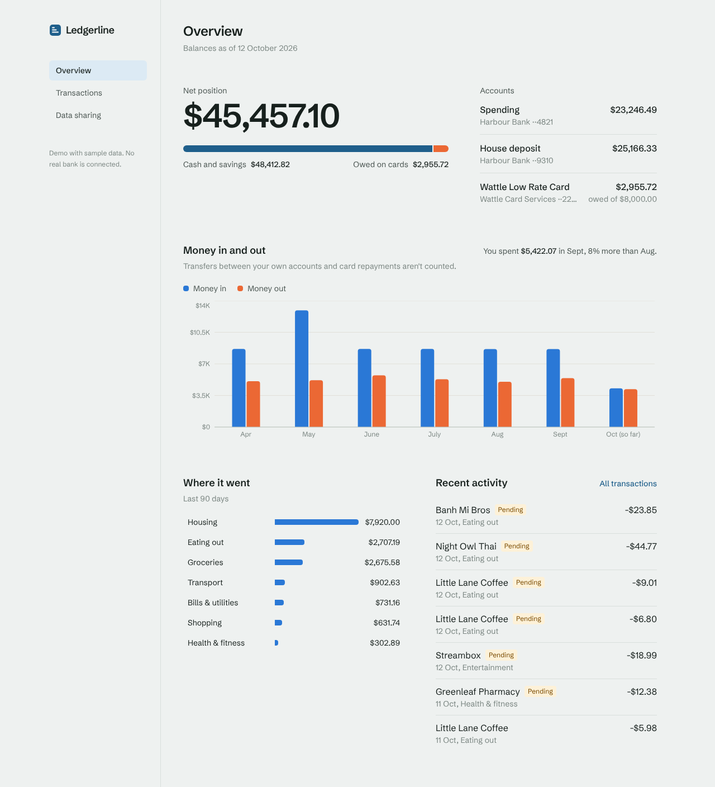
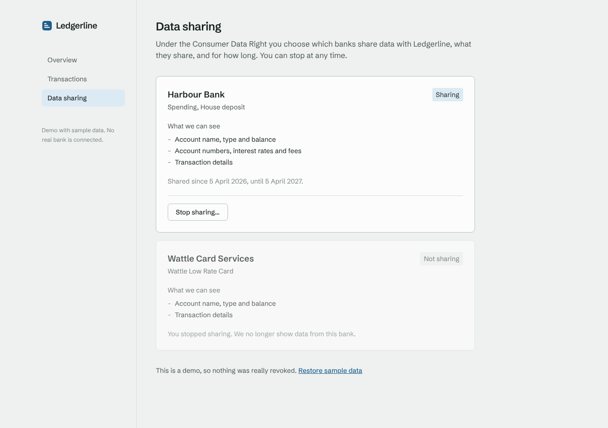

# Ledgerline

A personal finance dashboard built on Australian **Consumer Data Right (CDR)** banking data.
It brings accounts from several banks into one view: net position, money in and out each month,
where the money went, and a searchable transaction history. It also lets you see and stop each
bank's data sharing, the way CDR requires.

**Live demo:** _add your Vercel URL here_



> The demo runs on generated sample data. Every bank and merchant name is made up and no real
> bank is connected.

## Features

- **Overview:** net position (cash and savings against card debt), account balances, six months
  of cash flow, spending by category, recent activity
- **Transactions:** search plus account, category and direction filters, all kept in the URL so
  any filtered view can be bookmarked or shared; server-side filtering and pagination
- **Data sharing:** each bank's consent in plain language, with expiry warnings and a "Stop
  sharing" flow using a Server Action and optimistic UI. Revoking a consent removes that bank's
  accounts from every page
- Light and dark themes, works down to phone width, keyboard accessible, and charts come with a
  screen-reader table

## Stack

Next.js 16 (App Router, Server Components, Server Actions), React 19, TypeScript (strict),
Tailwind CSS 4, Recharts, Vitest with React Testing Library, ESLint, Prettier, and GitHub Actions
CI.

## Architecture

```
src/
  app/                    Routes. Server Components by default.
    page.tsx              Overview
    transactions/         URL-driven filters, server-side pagination
    data-sharing/         Consent list, Server Actions for revoke and reset
  components/             UI pieces. Client components only where needed
  lib/
    cdr/types.ts          CDR Banking API shapes (accounts, balances, transactions, consents)
    cdr/source.ts         BankingDataSource interface, picks an implementation
    cdr/mock-bank.ts      Deterministic sample data generator
    finance/              Pure functions: categorisation, cash flow, filters (unit tested)
    money.ts              Integer-cents money handling
    dashboard.ts          Loads data and applies consent, used by every page
```

Data flows one way. A page calls `loadBankingData()`, which reads from a `BankingDataSource`,
drops anything from a revoked consent, and categorises transactions. The page then passes plain
data to components. Pages never talk to a provider directly.

## Decisions worth explaining

**Money is integer cents.** CDR sends amounts as decimal strings (`"-42.50"`). They are parsed
once into cents at the edge (`lib/money.ts`) and formatted only at render time. Summing hundreds
of floats drifts, and a finance app that's off by a cent loses trust.

**The data layer matches the CDR standard.** `lib/cdr/types.ts` uses the real CDR field names
and enums. Adding a live provider (Basiq, Frollo or another accredited intermediary) means
writing one new `BankingDataSource` that maps their responses into these types. Nothing in the UI
changes.

**Transfers aren't spending.** Paying off a credit card from your everyday account looks like
$2,000 leaving. Counting it would double count the card purchases. Own-account transfers and card
repayments are categorised as `Transfers` and left out of spending and cash flow. A test checks
that they net to zero.

**Months are bucketed in Sydney time.** A purchase at 12:30am on 1 April AEDT is still 31 March
in UTC. Grouping by UTC would put it in the wrong month.

**Filters live in the URL.** The browser back button works, filtered views can be shared, and the
server filters the full data set instead of shipping everything to the client. Search is debounced
so typing doesn't fire a request per keystroke.

**Consent is enforced in one place.** `loadBankingData()` drops revoked banks before any page sees
the data, so no page has to remember to check. For the demo, revoked consent IDs live in an
httpOnly cookie, so each visitor has their own state and no database is needed. A real build would
call the data holder's revocation endpoint and store the record server-side.

**Sample data is deterministic.** A seeded PRNG generates six months of believable activity:
fortnightly pay, monthly rent, a card that is paid off each month, and merchant spend with real
merchant category codes. The same seed and date always give the same data, which keeps charts
stable and tests meaningful.

## Running locally

Requires Node 20.9 or later.

```bash
npm install
npm run dev        # http://localhost:3000
```

| Script           | What it does                    |
| ---------------- | ------------------------------- |
| `npm run dev`    | Development server              |
| `npm run build`  | Production build                |
| `npm test`       | Unit and component tests        |
| `npm run check`  | Lint, type check and tests      |
| `npm run format` | Format everything with Prettier |

CI runs formatting, lint, type check, tests and a production build on every push and pull request.

## What I'd do next

- A live `BankingDataSource` against the Basiq sandbox
- Budgets per category, with progress against the current month
- Playwright end-to-end tests for the consent flow
- Recurring payment detection (subscriptions, direct debits)

## Data sharing screen



## Licence

MIT
